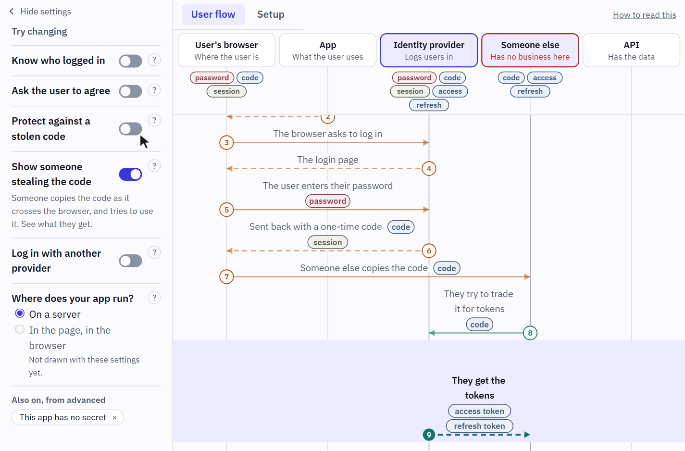

# Authlines

**Flip one thing. Watch the login change.**

OAuth and OpenID Connect on one diagram, recorded from a real server. It is for anyone who has to add a login, fix one or explain one: pick a question and follow it, one message at a time.

**[Open Authlines](https://vriesdemichael.github.io/authlines/)**

<picture>
  <source media="(prefers-reduced-motion: reduce) and (prefers-color-scheme: dark)" srcset="docs/readme/flip-dark-still.png">
  <source media="(prefers-reduced-motion: reduce)" srcset="docs/readme/flip-light-still.png">
  <source media="(prefers-color-scheme: dark)" srcset="docs/readme/flip-dark.png">
  
</picture>

Someone copied the code and gets the tokens. Turn on one setting, and the same request is refused. Both answers are what a real server said.

## What it does

- **One diagram, many settings.** PKCE, an attacker or another provider changes the diagram you already know, instead of opening another page.
- **Who has seen what.** Under each party is what it has been sent so far, so you can see that the browser saw the code and never the tokens.
- **The setup, not only the login.** How the app and the identity provider get to know each other has a diagram of its own.
- **As much detail as you want.** Simple mode says what happens and why. Advanced mode adds the raw requests and answers, which spec says so, and the Keycloak setting behind it.

## The recordings

Every request and answer on screen was recorded from a real Keycloak, and none is written by hand. A combination of settings with no recording says so and shows no payload, and a step only the spec describes is marked as that ([ADR-005](docs/adr/005-payloads-are-recorded-never-invented.md)).

### Where the recordings are

In [`static/recordings/`](static/recordings/), with a folder for each flow, a file for each named state, and what a real server answered to the questions the diagram makes a claim about in `questions.json`. Pictures of the pages a person gets are in `pages/`.

### How the recordings are made

`pnpm record` ([`scripts/record/`](scripts/record/)) starts a throwaway Keycloak in a container, sets up clients on Keycloak's defaults, and has a headless browser log in through a small demo app and API. Each recording is one real run, so the code returned in one step is the code sent in the next. The demo app and API really do the checks the steps say they do, such as the API checking a token's signature and audience ([`checks.ts`](scripts/record/checks.ts)), and a run stops if one fails.

### How the recordings are checked

- **On every change,** [a test](src/lib/recordings/recordings.test.ts) holds the diagram's data to the recordings in both directions: what it draws is in the recording, and what is in the recording is drawn, apart from what is only Keycloak's business. The click-through then compares the screen with the file, for every step of every named state.
- **Every week,** [a workflow](.github/workflows/recordings.yml) records against the latest Keycloak, compares that with what is committed, and opens an issue if it differs. Codes and tokens change on every run, so it compares which steps happened, what they carried and what the screen states about them.
- **By you.** Any request can be copied as a command, and [a page on the site](https://vriesdemichael.github.io/authlines/run-it-yourself/) gets the same server running at home, with Docker. The same workflow runs that page's commands.

The explanations are not recordings. They are written by hand, and a claim about a spec has a source, with [a test](src/lib/flow/citations.test.ts) holding it to the text of the RFC.

## What this is not

- **A debugger for your own server.** Nothing here talks to your server, or to any other: it replays what was recorded.
- **A comparison of vendors.** The protocol is explained neutrally, and what is Keycloak's own is a layer of notes on top ([ADR-015](docs/adr/015-keycloak-is-an-overlay-on-a-neutral-protocol.md)). It is recorded from Keycloak because anyone can run that, so someone on another identity provider still gets the protocol.
- **A tour of Keycloak's features.** A feature gets in when it teaches a concept or answers a question people bring.
- **An article.** There is no reading order. You pick a question, change settings and step through it.
- **Made for phones, yet.** Desktop comes first ([ADR-008](docs/adr/008-desktop-first-without-ruling-out-phones.md)).

Something wrong, or a question missing? [Say what is wrong](https://github.com/vriesdemichael/authlines/issues/new?template=something-is-wrong.yml) or [suggest a question](https://github.com/vriesdemichael/authlines/issues/new?template=suggest-a-question.yml).

## Run it

You need Node 22.20 ([`.node-version`](.node-version)) and pnpm, which `corepack enable` gets you at the version the repository asks for.

```bash
git clone https://github.com/vriesdemichael/authlines.git
cd authlines
corepack enable
pnpm install
pnpm dev
```

Then open the address it prints. `pnpm storybook` opens the components.

`pnpm verify` runs what CI runs, in one browser, which it needs first: `pnpm exec playwright install chromium`. CI also runs Firefox, WebKit and the screenshots, which `pnpm test:browsers` runs in CI's image, with Docker.

## Record it again

You also need Docker, and the browser from the step above.

```bash
pnpm record
```

That writes every recording again, on the version of Keycloak pinned in [`scripts/record/index.ts`](scripts/record/index.ts). `pnpm record --check` writes nothing and says what no longer holds, and `--keycloak` takes another version.

## Working on it

An AI agent, Claude, writes the code and the words here. The maintainer decides what it should be and judges what is deployed ([ADR-001](docs/adr/001-an-agent-builds-and-the-maintainer-reviews.md)).

The site and [its Storybook](https://vriesdemichael.github.io/authlines/storybook/) update on every merge to `main`, and each pull request gets a preview of both.

- [Premise](docs/premise.md): what this is, why, the nuances, and what happens next
- [Target states](https://github.com/vriesdemichael/authlines/issues?q=is%3Aissue+label%3A%22target+state%22): where it is going, with acceptance criteria and deliverables
- [Original brief](docs/original-brief.md): the idea in the maintainer's own words
- [Decision records](docs/adr/index.md): the rules for how it is built and worked on
- [Research](docs/research/README.md): what already exists, what is left open, and how far to trust that

### Where things live

- `src/lib/flow/`: what a base flow is, the data of each one, and what is on screen in a given state. Nothing about a view or a product.
- `src/lib/diagram/`: the geometry and the motion of the diagram, as pure functions.
- `src/lib/recordings/`: what was recorded of each flow, and how a message is known.
- `src/lib/keycloak/`: everything about one product, which the protocol layer never mentions (ADR-015).
- `src/lib/map/`: the questions on the home screen.
- `src/lib/search/`: search, including what it knows about errors.
- `src/lib/sources/`: the specs and docs that the settings and steps name.
- `src/lib/components/`: the view, with a story for each state of each component (ADR-007).
- `scripts/record/`: the real Keycloak, the demo app and API, and what gets tried on them (ADR-005).
- `scripts/readme-clip.ts`: the picture at the top of this page, which `pnpm build`, then `pnpm clip`, makes again.

Adding a setting is mostly data in `flow/`, a recording and tests. A second base flow gets its own diagrams, settings, recordings and notes, and `flow/second-flow.fixture.ts` is a small one that keeps that true.

## Licence

Code is under [Apache-2.0](LICENSE) and content is under [CC BY 4.0](LICENSE-CONTENT), so you can reuse and modify both with attribution. [NOTICE](NOTICE) says what to credit, and [ADR-009](docs/adr/009-code-is-apache-and-content-is-cc-by.md) says what counts as which.
